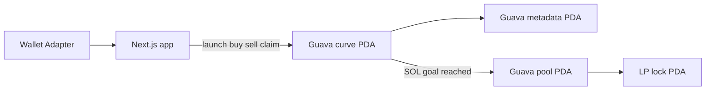

Track B — Solana

Guava (Gua, gua.fun, ticker GUAV) is a devnet token launchpad and discovery board called The Grove. Tagline: **Ripe launches. Fresh pairs.**

Product shape (a board, a launch form, and a trade panel) was studied from a public memepad, avo.fun. Guava is an original brand and a separate program.

## Phase 1

Solana **devnet** demo. Mainnet is out of scope. `declare_id!` is a placeholder until `anchor keys sync` or a real deploy replaces it. This checkout has not been deployed.

Quote asset on the curve is **native SOL**. USDC and stock pairing are not on the curve. There is no external DEX CPI. Graduation opens a constant-product pool inside this same Anchor program and locks LP there.

## Architecture



PDA seeds:

| Account | Seeds |
|---|---|
| Config | `["config"]` |
| Mint | `["mint", creator, ticker]` |
| Curve | `["curve", mint]` |
| Metadata | `["metadata", mint]` |
| Token vault | `["vault", mint]` |
| Pool | `["pool", mint]` |
| LP mint | `["lp-mint", mint]` |
| LP lock | `["lp-lock", mint]` |
| Lock authority | `["lock-auth", mint]` |

`lock-auth` is never a signer. There is no withdraw instruction. After minting LP, mint authority is revoked.

## Curve and graduation

Virtual reserves at launch:

- Virtual SOL: **30 SOL** (`30_000_000_000` lamports)
- Virtual tokens: **1,073,000,000** tokens (6 decimals)
- Real tokens available on the curve: **800,000,000**
- Fixed supply: **1,000,000,000**. The other 200,000,000 stay in the vault and join the pool at graduation.
- Decimals: 6. Mint authority is revoked after the initial mint.

Buy (fees taken from input SOL, then constant product on the net):

```
tokens_out = virtual_token - (virtual_sol * virtual_token) / (virtual_sol + sol_net)
```

Sell is the inverse. Gross SOL out pays the same fee split. Spot market cap is `quote_reserve * supply / token_reserve`. While the curve is open the quote reserve is virtual SOL. After graduation it is the pool’s real SOL.

Graduation threshold is stored on config at `initialize` and copied onto each curve.

| Value | Lamports | Role |
|---|---|---|
| Devnet script default | `2_000_000_000` (2 SOL) | What `scripts/initialize-config.ts` writes |
| Tests | same 2 SOL | Local validator |
| Mainnet-shaped constant | `85_000_000_000` (85 SOL) | Documented only. Not deployed. Not a live claim. |

When `real_sol_reserves` reaches the threshold inside `buy` (including a large first buy), the program:

1. Moves that SOL into a new pool account
2. Sets pool token reserves to the remaining vault balance
3. Mints LP (`sqrt(sol * tokens)`) to the lock account
4. Revokes LP mint authority
5. Marks the curve `complete` and `graduated`

Later buys and sells use the pool’s real reserves, with the same fees. Price can step at graduation because virtual reserves are not copied into the pool. The token page says which venue is live.

## Fee math

Fees round down. Platform is **100 bps (1%)**. Creator fee is **0–500 bps**. A creator fee above 500 is rejected.

Worked buy of **1 SOL** with a **2%** creator fee, against the initial virtual reserves:

| Piece | Lamports | SOL |
|---|---|---|
| Input | 1,000,000,000 | 1 |
| Guava 1% | 10,000,000 | 0.01 |
| Creator 2% | 20,000,000 | 0.02 |
| Net to the curve | 970,000,000 | 0.97 |
| Tokens out | 33,607,039,070,068 raw | 33,607,039.070068 tokens |

Creator fees sit on the curve account until `claim_creator_fees`. Platform fees transfer immediately to the configured recipient. Launch itself charges network fees only.

UI copy: “1% to Guava + your creator fee”. Trade fee ≈ 1% + creator fee.

## What is live vs stubbed

| Piece | State |
|---|---|
| Launch, buy, sell, claim, graduation, LP lock | Implemented in the Anchor program. Tests cover them on a local validator. |
| App routes `/`, `/launch`, `/token/[address]`, `/profile`, `/legal` | Implemented and wired to the program when `NEXT_PUBLIC_GUAVA_PROGRAM_ID` is set and config exists. |
| Wallet | Solana Wallet Adapter. Optional Privy app id is in `.env.example` and is not required. |
| Metadata | Guava metadata PDA (name, ticker, uri, description). Metaplex is a follow-up. |
| Image | Local preview and `localStorage`. On-chain uri is `guava:local` or a short http url. Object storage is not wired. |
| Grove freshness | Polls program accounts every 8s. Empty or failed index shows 6 labeled demo rows and a “Demo data” footer. |
| Live volume and 24h change | Not invented. Cells stay “—” until a trade index exists. Demo rows are labeled. |
| Chart | Placeholder. It does not draw candles. |
| Plain 0% pool mode | Shown as Soon. Not implemented. |
| Mainnet, external DEX migration, stock pairing | Out of scope. |

## Run the app

```bash
npm install
cp .env.example .env.local
npm run dev
```

`npm run build` typechecks and builds. `npm run lint` runs Next lint.

With the program id unset, The Grove shows demo data and launch still previews the card.

## Build, test, deploy the program

Requirements: Anchor CLI 0.32.1, Solana CLI, Rust 1.89 (the repo pins this in `rust-toolchain.toml`).

The placeholder program id in source is `67HiGDKWjYSgGQNq7icz6vPRNNQAMogdzdJvgztYYPmX`. The matching keypair is `keys/guava-program-keypair.json` (local, unfunded). `anchor keys sync` rewrites `declare_id!` if you generate a different key.

```bash
npm run anchor:build
npm run anchor:test
```

`anchor:test` runs the TypeScript suite against a local validator (`anchor test`).

Deploy to devnet only after a keypair is funded:

```bash
# use a funded devnet wallet instead of keys/local-test.json
npm run anchor:deploy
SOLANA_RPC_URL=https://api.devnet.solana.com \
GUAVA_PROGRAM_ID=<program id> \
GUAVA_FEE_RECIPIENT=<pubkey> \
GUAVA_KEYPAIR=<funded json> \
npx ts-node --compiler-options '{"module":"commonjs"}' scripts/initialize-config.ts
```

Then set `NEXT_PUBLIC_GUAVA_PROGRAM_ID` and restart the app. Do not claim mainnet. Explorer links use `https://explorer.solana.com/?cluster=devnet`.

## Licenses

This repository is MIT (`LICENSE`). Anchor and `anchor-spl` are Apache-2.0. The curve math is original Guava code, not a copied program id.

## Placeholder logo

See [docs/BRAND.md](docs/BRAND.md). A designer still needs to draw the mascot. The in-repo SVG is a placeholder cross-section only.
